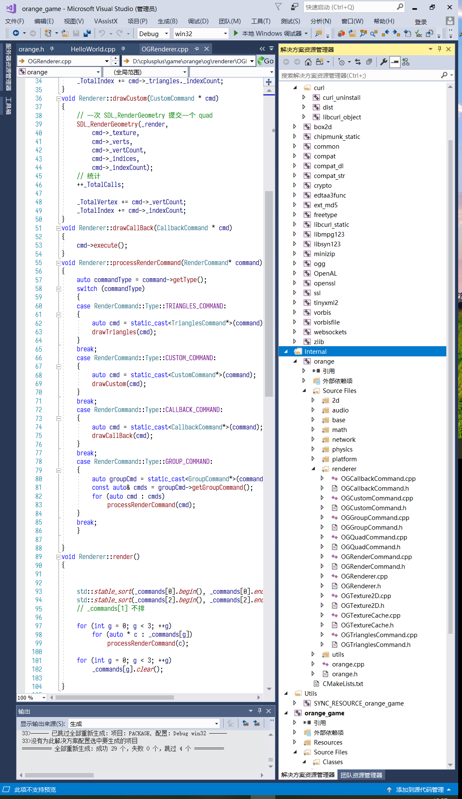
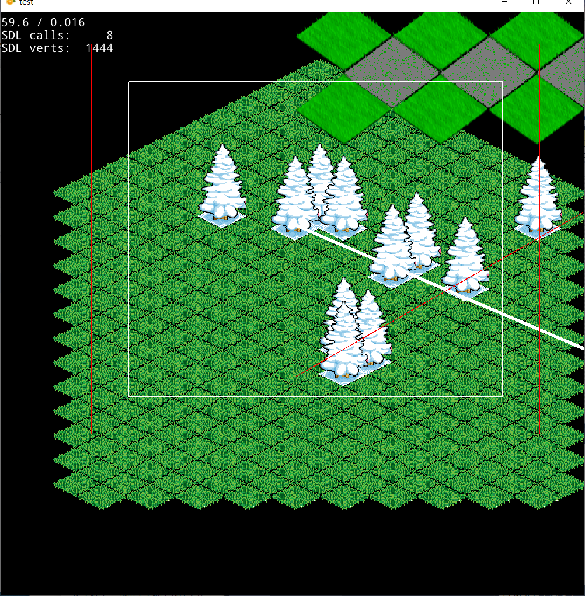
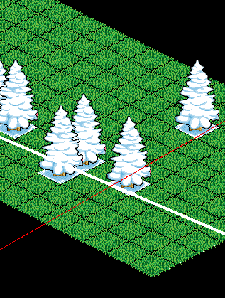
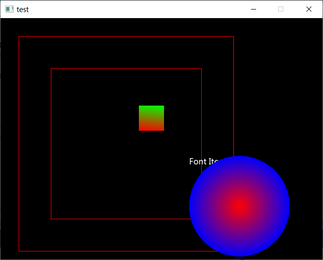
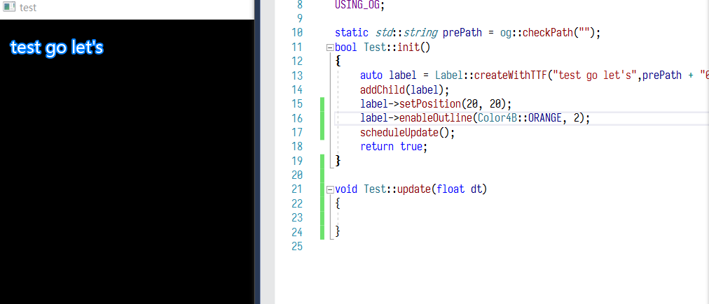
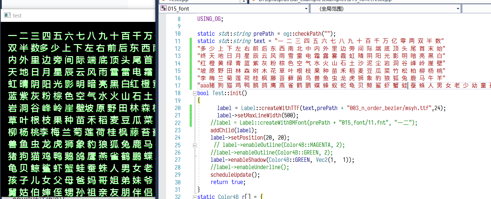
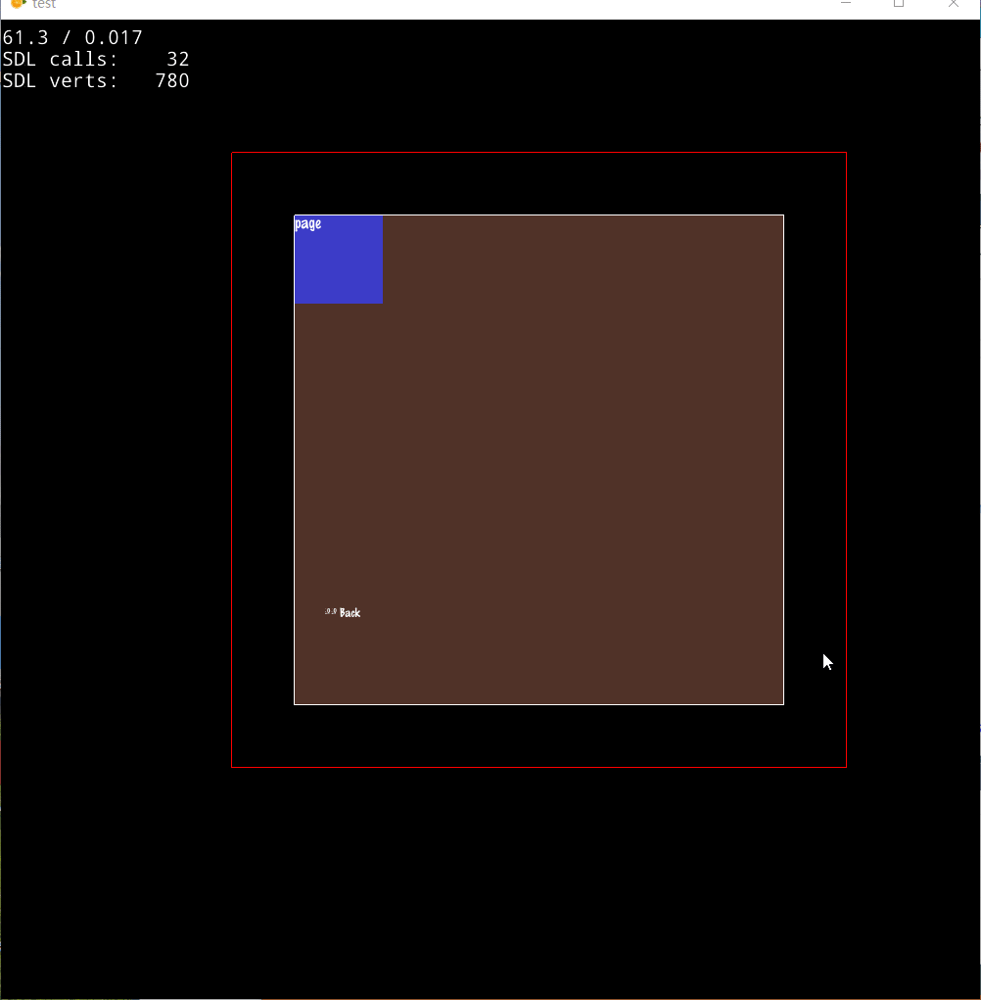

# orange Game Engine (vertices-cpp)

轻量级 2D 游戏引擎，纯 C/C++ 实现，依赖尽量收敛为单头库与少量成熟 C 库。

## 架构总览

- **核心**：框架事件、Scheduler、基础类型（基本稳定，无大改）
- **模块划分**：`2d` / `audio` / `base` / `math` / `network` / `physics` / `platform` / `render` / `utils` / `ui`（UI 测试中）

## 依赖与选型

| 领域 | 选型 |
|---|---|
| 网络 | libwebsocket / curl / openssl |
| 物理 | Box2D / Chipmunk2D |
| 音频 | OpenAL + mpg123 + vorbis + ogg（已修复调试恢复后的音频中断与退出报错） |
| 图片 | stb_image / stb_image_write |
| XML | SAX 解析改为 tinyxml2，地图等一律使用 tinyxml2 |
| 渲染 | 统一改为 `SDL_RenderGeometry` |
| 相机 | 带类似 2D 视锥体剔除 |
| 压缩包 | 新增 `zip.h` / `zip.c`，支持对异或/加密 zip 文件的查询 |
| 字体 | FreeType 2 (ft2) |
| 转码 | 提取 iconv 库的单头实现，支持 UTF-8 / UTF-16LE / UTF-32LE 互转 |
| JSON | 统一改为单头库 |

## 已实现特性

- 粒子系统、丝带效果
- 各类地图、节点绘制
- 2D 转场翻页特效
- 相机视锥体剔除
- 加密/异或 zip 查询

## 截图与演示

### 图片 / GIF（可直接内嵌显示）

动图演示：

### 视频演示

> ⚠️ GitHub 的 Markdown 渲染器**不支持**在 README 中用相对路径内嵌 `<video>` 播放本地 mp4。
> 因此这里用链接方式，点击后进入 GitHub 文件页，可在线播放（GitHub 对仓库内 .mp4 文件有内置播放器）。

- [▶ 演示视频 1](screenshot/Video_1792605339470.mp4)
- [▶ 演示视频 2](screenshot/Video_1792605475288.mp4)
- [▶ 演示视频 3](screenshot/Video_1792605580496.mp4)

> 💡 如果希望视频在 README 页面内**直接自动播放**，可将其转为 GIF（如上面的 `Image_1792606943630.gif`），或在 Issue/PR 评论框里拖拽上传 mp4 生成 `user-attachments` 链接后内嵌。

## 目录结构（节选）
